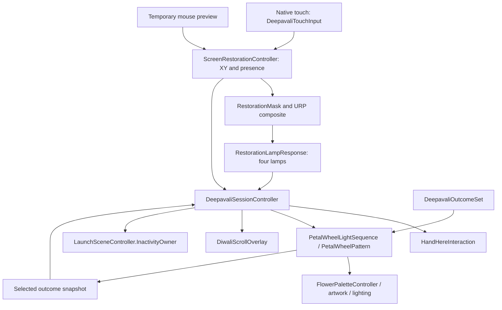

# Deepavali architecture

Inspected 29 October 2026 against runtime source, main-scene references and saved settings. Paths below are relative to the repository. Earlier scope/planning documents retain their historical requirements; this page describes the implementation.

## Ownership and data flow

| Component / source directory | Responsibility |
| --- | --- |
| [Restoration/Scripts](../Assets/HK_Signature/Deepavali/Restoration/Scripts) | `DeepavaliSessionController` owns phase transitions; `.Scroll.cs` owns matching video orchestration/settings save; `.Inactivity.cs` owns activity, fade/reset and host ownership. |
| Same directory: `ScreenRestorationController`, `RestorationMask`, `RestorationRenderPass` | Sample pointer, accumulate coverage, manage runtime mask/material, and enqueue a camera-specific URP pass after post-processing. RenderGraph and compatibility paths are implemented. |
| Same directory: `RestorationLampResponse` | Sample restoration at the background lamp anchors, latch ignition and apply flame/light/soil levels. |
| Same directory: `DeepavaliTouchInput`, `DeepavaliSessionDebugUI`, `DeepavaliSessionSettings` | Touch adapter, M-key controls and persisted session parameters respectively. |
| Same directory: `DeepavaliSessionController.Presentation.cs` | Session-local camera pitch and spin tuning, and fade visibility for the scene's result-logo Image/CanvasGroup. |
| [UI](../Assets/HK_Signature/Deepavali/UI) | `HandHereInteraction` owns prompt appearance, hit rectangle, dwell display and dismissal notification; `HandHereGraphic`/`HandGuidanceCanvas` support presentation. |
| [PetalPrototype/Scripts](../Assets/HK_Signature/Deepavali/PetalPrototype/Scripts) | `PetalWheelPattern` owns wheel modes/timing. `PetalWheelLightSequence` applies pattern lighting/result state. `FlowerPaletteController` and its partials own palettes, initial/center state, artwork, transitions and lighting. `PetalArtworkController` handles per-petal artwork. |
| [Background/Scripts/DeepavaliBackground.cs](../Assets/HK_Signature/Deepavali/Background/Scripts/DeepavaliBackground.cs) | Soil, lamp placement/flicker and background behavior. Restoration modulates existing authored lamp levels. |
| [DiwaliScrollOverlay.cs](../Assets/DiwaliScroll/Scripts/DiwaliScrollOverlay.cs) | Three reusable VideoPlayers, named variants, prepare/show/hide/cancel and bounded playback failure handling. |
| [LaunchSceneController.cs](../Assets/Scripts/Game/LaunchSceneController.cs) | Persistent host navigation and screensaver timer; yields idle handling to an active `InactivityOwner`. |

## Session flow

The state enum is in [DeepavaliSessionController.cs](../Assets/HK_Signature/Deepavali/Restoration/Scripts/DeepavaliSessionController.cs). It is more detailed than the original brief's Idle/Restore/Reveal stages.

| Phase(s) | Transition / gate |
| --- | --- |
| `AwaitingRestoration` | Prompt appearance must finish, then continuous center dwell completes. First session allows a pointer already at center; later prompts must be armed by a known outside position. |
| `DismissingRestorationPrompt` | `HandHereInteraction.Despawned` enables painting and reveals a small center area. |
| `Restoring` | Coverage reaches `requiredCoverage` **and** `LitLampCount == 4`; painting stops and full completion reveal starts. |
| `FinalReveal` | Restoration reaches `Idle` and the wheel is active/initialized; display the spin prompt. |
| `AwaitingSpin`, `DismissingSpinPrompt` | Fresh outside-to-inside entry and spin dwell, followed by prompt dismissal. |
| `EnteringWheel` | Enter wheel pattern and wait for `Ready`, then call `Spin()`. |
| `Spinning` | Pattern reaches `Win`; snapshot/prepare the selected scroll. |
| `RevealingResult` | Wait for `IsResultFullyVisible` (bloom and palette transition complete), then start scroll delay. A reveal watchdog resets if completion stalls. |
| `ScrollDelay`, `ScrollOpening`, `ScrollHolding`, `ScrollClosing` | Delay after reveal; wait for prepared media; show the exact variant; hold fully open; hide; begin the greeting only when hidden. |
| `HoldingResult` | No overlay or failed playback: retain the chosen flower for `coloredHoldDuration`, then try the greeting. Do not choose another blessing. |
| `GreetingOpening`, `GreetingHolding`, `GreetingClosing` | Keep the selected rangoli visible; play the alpha title opening, hold fully written for 4 seconds, play its closing clip, then reset. |
| `ReturningToBase` | Inactivity fade out, reset at black, fade in, then show the opening prompt. |

`EndSequence()`/`endSequence()` share the synchronous `ResetSession(false)` path, clearing pending scroll and greeting playback, prompt/dwell, mask, lamp state via restoration reset, initial flower appearance, wheel and inactivity state. Disable releases host ownership and cancels pending work without respawning the prompt. Required references include restoration, four background lamps, prompt, wheel and flower; integrated wheel result bloom must be enabled or session initialization fails.

The session disables restoration's standalone auto-completion and the wheel's auto-preview, and holds the selected result through scroll playback. Shimmer runs beneath the restoration mask from the first stroke and continues through completion. Other configured idle behaviors resume at completion; the wheel must not be put back into that paused list for the integrated scene.

## Pointer and restoration contract

- `DeepavaliTouchInput` uses EnhancedTouch native screen positions, retaining one contact until it ends/cancels. It excludes mouse touch simulation and filters display/viewport. Contact replacement calls `ClearPointer()` to break interpolation and restart dwell.
- `SetPointerScreen(Vector2, bool)` uses **bottom-left screen pixels**, subtracting the interaction camera's pixel-rect offset. `SetPointerViewport(Vector2, bool)` takes normalized bottom-left viewport coordinates. External adapters should disable the existing touch adapter and mouse route, feed presence continuously, and clear it on loss. No vendor receiver or calibration transform is supplied here.
- Pointer continuity versions invalidate dwell across gaps/handover. Stationary touch remains present for dwell/painting, but tiny jitter or repeated stationary samples do not refresh inactivity. Stale external samples expire using `inputTimeout`.
- M-menu UI blocks painting/dwell within its panel via `BlocksMouseScreenPoint`. Opening it does not resize the camera viewport.
- `RestorationMask` accumulates a soft brush in a CPU byte mask uploaded to an R8 texture. Coverage is computed within `completionArea`, not as a count of petal objects. Radius is expressed in viewport heights with aspect correction. This is continuous screen restoration, not the originally proposed per-region component system.
- `RestorationRenderPass` composites the dark/desaturated and restored image after post-processing on the assigned camera. `ScreenRestorationController` owns allocation, render callbacks and cleanup. Changes to camera/render pipeline configuration need visual verification.
- Lamp ignition latches once its sampled restoration exceeds the lamp threshold. The integrated completion gate combines lamp count with coverage, rather than using standalone `completionCoverage` alone.

## Flower, result mapping and media

The refined flower has **8 inner petals + 14 outer leaves**. Wheel clockwise arrays map renderer indices; they must be complete and distinct. Meshes, fitted light/artwork maps and per-petal assignments are coupled. The production model is [Deepavali_RefinedFlower.fbx](../Assets/HK_Signature/Deepavali/PetalPrototype/Models/Refined%20Flower/Deepavali_RefinedFlower.fbx); editable Blender evidence is under `output/flower-petal-prototype/`.

[Deepavali Outcomes.asset](../Assets/HK_Signature/Deepavali/PetalPrototype/Rendering/Light%20Sequence/Deepavali%20Outcomes.asset) is the shared mapping for opening symbols, selected palette/icon and scroll variant. Current clockwise order:

| Slot (zero-based) | Symbol | Palette | Scroll variant |
| --- | --- | --- | --- |
| 0 | Sprout | Red | Red |
| 1 | Diya | Orange | Orange |
| 2 | Star | Blue | Blue |
| 3 | Stacked Coins | Green | Green |
| 4 | People and Heart | Pink | Pink |
| 5 | Gift Box | Cyan | Cyan |
| 6 | Sunburst | Gold | Yellow |
| 7 | Lotus | Purple | Purple |

`DeepavaliOutcomeSet.Validate()` checks eight distinct mappings and valid icons. `PetalWheelLightSequence.SelectedOutcome` snapshots the winning entry. The integrated path uses `flower.outcomeSet`; `style.outcomes` remains the fallback for legacy scenes. Preserve enum values (`Base, Gold, Pink, Purple, Green, Blue, Orange, Cyan, Red`) and serialized references when changing assets. Do not independently randomize the scroll.

`FlowerPaletteController` partials separate initial state, center, artwork, pattern, outcomes, sequence and lighting. Color transitions and artwork reveal have their own progress handling; a landed wheel is not the same as a completed flower reveal. The session waits for the latter before counting the scroll delay.

The scroll prefab has eight named variants, each with spawn/idle/hide WebM clips (VP8 import with alpha). The session disables `showOnStart`, `toggleOnMouseClick` and `waitForIdleLoopEnd`, prepares the selected variant and controls playback. Typical media lengths are about 5.6 s opening and 3.4 s closing; actual player state determines completion. The 15 s hold excludes both. Media errors use the bounded fallback above. See [scroll integration evidence](../output/diwali-scroll-integration/README.txt).

The integrated scene alone adds an `AMGEN Logo Placeholder` Image beneath the scroll's fitted RectTransform; its CanvasGroup starts at zero alpha with input disabled. `.Presentation.cs` derives fade progress from `ScrollPhaseElapsed` only in `ScrollHolding` with a healthy, shown overlay. It therefore starts after the first idle video frame, not a guessed opening duration. Closing/fallback hide it; `CancelScroll()` also hides it synchronously for reset/disable. During inactivity return it remains under the black fade until reset at black. There is no extra hold or new phase. The approved scroll-logo sprite remains pending. The separate Happy Deepavali finale follows scroll closing.

## Happy Deepavali finale

[HappyDeepavaliOverlay.cs](../Assets/HappyDeepavali/Scripts/HappyDeepavaliOverlay.cs) plays the supplied 2560 × 1118 alpha WebM title (5.6 s writing / 4 s idle loop / 1.4 s hiding). The integrated scene adds `Happy Deepavali Canvas/Happy Deepavali`, sorted at 1001, above the rangoli and scroll and below the inactivity fade. Its separate Logo RawImage uses the supplied AMGEN placeholder. `.Greeting.cs` owns the appended greeting phases, keeps the selected outcome and full restoration visible, and resets only after the overlay becomes Hidden. The session disables startup/click playback. The package player is hardened with unscaled time, first-idle-frame Shown notification, playback watchdogs and synchronous cancellation on reset/disable. Missing/disabled/failed greeting playback returns to the opening; scroll fallback attempts the greeting after its colored hold. Existing phase enum values are preserved.

## Saved defaults and clocks

Values below come from [Deepavali Session Settings.asset](../Assets/HK_Signature/Deepavali/Restoration/Deepavali%20Session%20Settings.asset), applied at `Start()`. Standalone component defaults may differ.

| Setting | Saved value |
| --- | --- |
| Opening / spin dwell | 0.65 s / 0.15 s |
| Required coverage | 0.8, plus all four lamps |
| Brush radius | 0.32 viewport heights |
| Opening center reveal radius | 0.16 viewport heights |
| Center light intensity / fade | 0.6 / 0.6 s |
| Inactivity timeout / total fade | 30 s / 2 s |
| Scroll delay / fully-open hold | 2 s / 15 s |
| Fallback colored result hold | 10 s |
| Camera pitch offset from authored view | 0 degrees |
| Spin speed / minimum cruise / slowdown | 16 slots/s / 1.2 s / 3.6 s |
| Logo fade after scroll opening | 1 s |
| Fully written Happy Deepavali hold | 4 s |

Session dwell, inactivity and hold use unscaled/realtime clocks; the wheel's normal update uses `Time.deltaTime`. Do not assume time-scale changes affect the whole experience uniformly. Settings save is Editor-only; runtime build tuning is temporary.

Session settings apply the three spin fields to the live `sequence.timing` object after the wheel loads its shared preset. The pattern keeps that reference, but snapshots motion when `Spin()` starts. No wheel algorithm, shared preset, outcome mapping or study-scene defaults changed. The session's LateUpdate propagates Inspector/M-menu adjustments before triggering the next spin. Camera pitch is an absolute orbit around the flower from a captured authored transform; repeated application does not accumulate rotation. Zero offset and session disable restore the authored view. Logo fade uses the existing unscaled scroll clock.

## Inactivity and host boundary

Meaningful pointer movement, tracking acquisition or explicit input actions refresh the session timer. Animation and phase changes do not. After 30 s without activity, interactive phases and the wheel/reveal can enter `ReturningToBase`. Once the result presentation starts (scroll delay, scroll playback, fallback colored hold or greeting), timeout is deferred until the presentation completes and resets. The elapsed inactivity clock still accumulates; it is not refreshed by animation. The 2 s fade resets at black. An already idle base stays visible without repeated fades.

The active session claims `LaunchSceneController.InactivityOwner` and releases it on disable. The host resets its timer and skips its idle update while that owner is active. This prevents competing host screensaver transitions; it does **not** disable the module's own timeout during interaction, wheel or reveal. Scroll and greeting phases now complete without timeout interruption; explicit reset and disable still cancel immediately.

There is no fixed 45-second restoration countdown in this controller. The earlier scope's timed full-reveal requirement and the current activity-driven return are different behaviors. Record this distinction when assessing acceptance; do not present the original plan as delivered behavior.

Scene navigation/build inclusion is still separate: no Deepavali scene is enabled in build settings. Validate host entry/exit, physical touch and target-wall rendering when integration is undertaken. See [validation](validation.md).
